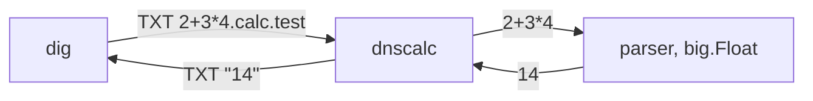

<p align="center">
  
</p>

<p align="center"><b>A DNS server that evaluates math.</b> The query name is the expression, and the TXT answer is the result.</p>

<p align="center">
  <a href="https://github.com/Crank-Git/dnscalc/actions/workflows/ci.yml"></a>
  <a href="https://github.com/Crank-Git/dnscalc/releases"></a>
  
  <a href="LICENSE"></a>
</p>

<p align="center">
  <a href="docs/reference.md"><b>Docs</b></a> ·
  <a href="#install"><b>Install</b></a> ·
  <a href="#quick-start"><b>Quick start</b></a> ·
  <a href="https://github.com/Crank-Git/dnscalc/releases"><b>Releases</b></a>
</p>



## Why dnscalc

DNS will carry a surprising amount if you treat the query name as input. dnscalc takes
that literally: every label in front of the zone is the expression, and the answer comes
back as a TXT record. Any resolver or `dig` you already have is the client.

The parser is hand-written recursive descent over `*big.Float` at 1024-bit precision, with
no `eval`, no shelling out, and no expression library. It handles `+ - * / ^`, unary minus,
parentheses, and `tet` for tetration.

The hard part was making a single query safe. Values are range-checked as soon as they're
produced, powers are estimated before they're computed, towers stop as soon as they settle,
and a result too long for one TXT string gets split across several so it still arrives.

## Requirements

- **`dig`**, or any DNS client that can send a TXT query to a custom port.
- **Go 1.26.5 or later**, only if you build from source or run the tests.

## Install

Prebuilt binaries for macOS, Linux, and Windows (amd64 and arm64) are attached to each
[GitHub release](https://github.com/Crank-Git/dnscalc/releases):

```
$ curl -LO https://github.com/Crank-Git/dnscalc/releases/latest/download/dnscalc_linux_amd64.tar.gz
$ tar xzf dnscalc_linux_amd64.tar.gz
```

Each release also has a `dnscalc_<version>_checksums.txt` with SHA-256 sums of the
archives.

From source:

```
$ go build -o dnscalc .
```

## Quick start

Start the server. With no flags it listens on `127.0.0.1:8053`, UDP and TCP, under the
zone `calc.test.`:

```
$ ./dnscalc
```

Then ask it something from another terminal:

```
$ dig @127.0.0.1 -p 8053 +short TXT '2+3*4.calc.test'
"14"
$ dig @127.0.0.1 -p 8053 +short TXT '1/0.calc.test'
"error: division by zero"
```

An invalid expression still answers `NOERROR`, with the reason in the TXT record. Every
query logs one line on the server:

```
2026/01/01 12:00:00 qname=2+3*4.calc.test. qtype=TXT rcode=NOERROR result=14
```

## Usage

| Flag | Default | Meaning |
|---|---|---|
| `-listen` | `127.0.0.1:8053` | Address to serve on (`host:port`). |
| `-zone` | `calc.test.` | Zone suffix the expressions hang under. Any case, trailing dot optional. |

The expression is every label before the zone, joined with `.`. A `.` between two digits
is a decimal point, and a `.` between two words is a separator, so `1.5*2.calc.test` is
`1.5*2` and `2.plus.3.calc.test` is `2.plus.3`.

Parentheses and spaces work directly in names. `dig` escapes them on the way out and the
server unescapes them before evaluating:

```
$ dig @127.0.0.1 -p 8053 +short TXT '(2+3)*4.calc.test'
"20"
$ dig @127.0.0.1 -p 8053 +short TXT '2 tet 3.calc.test'
"16"
```

A few things to know:

- A label is at most 63 bytes, so split long expressions with `.` at a word boundary
  (`2^100.plus.3^50`).
- `dig` reads an argument that starts with `-` as an option. Pass that name with `-q`, or
  start it with the `minus` alias: `minus.2^2.calc.test` answers `"-4"`.
- Word aliases (`plus`, `minus`, `times`, `over`, `pow`, `lp`, `rp`) and the zone match in
  any case, so resolvers that randomize case with 0x20 still work.

## Documentation

| Page | What's there |
|---|---|
| [Reference](docs/reference.md) | Operators and precedence, word aliases, limits, output formatting, and the answer for every kind of query. |
| [DECISIONS.md](DECISIONS.md) | The rules the evaluator and the server follow, and why. |
| [CONTRIBUTING.md](CONTRIBUTING.md) | The CI checks, the project layout, and how releases are cut. |

## Development

```
$ go test ./...            # unit, in-process DNS, and e2e tests
$ go test -short ./...     # skip the e2e tests (no binary build, no dig)
$ go test -race ./...      # with the race detector, as CI runs it
$ go test -run='^$' -fuzz=FuzzEvaluate -fuzztime=30s   # fuzz
```

`e2e_test.go` builds the binary and queries it over real DNS with `dig`. It skips if
`dig` isn't installed, unless `DNSCALC_REQUIRE_DIG=1` is set, which is how CI runs it.
`bigmath_test.go` and `tetration_test.go` check fractional powers and towers against
references computed separately with Python's `decimal` module.

## License

MIT. See [LICENSE](LICENSE).

---

<sub>Part of <a href="https://github.com/Crank-Git#things-over-port-53"><b>Things over port 53</b></a>,
my experiments in what else DNS can carry.
Siblings: <a href="https://github.com/Crank-Git/epochalypse">epochalypse</a> ·
<a href="https://github.com/Crank-Git/mcport53">mcport53</a> ·
<a href="https://github.com/Crank-Git/wingman">wingman</a> ·
<a href="https://github.com/Crank-Git/cachemoney">cachemoney</a> ·
<a href="https://github.com/Crank-Git/llamaoverdns">llamaoverdns</a> ·
Built by <a href="https://github.com/Crank-Git">Crank</a></sub>
